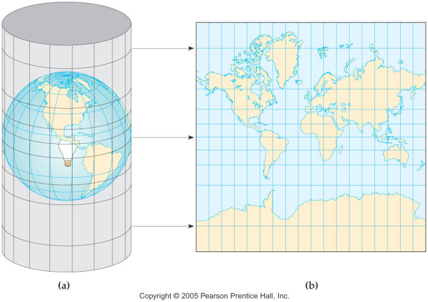
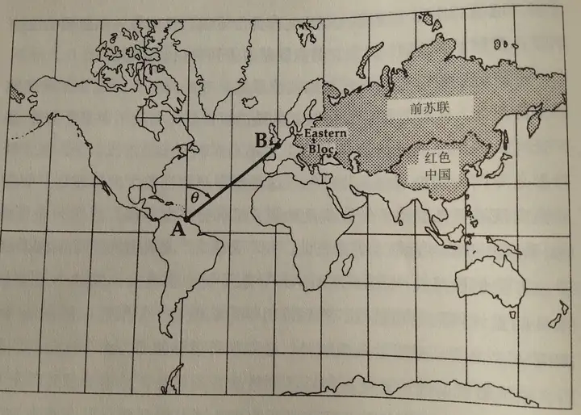

## 1、坐标系概述

- 平面直角坐标系：精确描述平面上的点

- GIS 坐标系：精确描述地球上的点
  - 坐标系分两类：`地理坐标系` 与 `投影坐标系`

## 2、地理坐标系（GCS）

用经纬度在三维球面上定位。

- `纬线`（东西方向）→ 纬度；`经线`（南北方向）→ 经度
- 地球的形状由`球体`或`旋转椭球体`定义
  - 小比例尺地图（≤ 1:5 000 000）：用球体即可
  - 大比例尺地图（≥ 1:1 000 000）：用旋转椭球体更准
- 常用椭球 WGS84（世界大地坐标系，1984 年提出）参数：
  - 长半轴 a = 6378137.0 m
  - 短半轴 b = 6356752.31424 m
  - 扁率 1/f = 298.25723563

> 补充（可略过）：地心坐标系把地球建模为从地心出发的右旋 XYZ 三维笛卡尔坐标系——X 指向本初子午线、Y 指向赤道且与 X 成 90°、Z 指向北极。常用于计算，而非直接展示。地心坐标系与基于经纬度的地理坐标系类似，均从地心开始测量角度。

## 3、投影坐标系（PCS）

把三维球面「摊平」成平面，必然产生变形。

- 始终基于某个地理坐标系
- 原点 x=0、y=0，x 表示水平位置、y 表示垂直位置
- 地图投影 = 用数学公式把球面坐标映射到平面坐标

### 3.1、Mercator（墨卡托）投影

- 圆柱投影：经线平行且等距，纬线越靠近两极间距越大，且显示不到极点
- 墨卡托投影基于完美球体，球体半径为 WGS1984 半长轴的长度 6378137.0 米。
- 特点：`等角`（保持方向），适合航海

  
  - 航海：A 到 B 画直线，量出它与子午线的夹角，照此角度航行即可

  

### 3.2、UTM（通用横轴墨卡托）投影

- 横轴圆柱投影：把地球按经度分成 60 个 6° 带，每带单独投影，变形小、适合中低纬度大比例尺制图。

### 3.3、高斯-克吕格（Gauss-Krüger）投影

- 与 UTM 类似的横轴等角投影，分 3° 或 6° 带；中国国家标准地形图使用此投影（如 CGCS2000 分带坐标）。

### 3.4、兰勃特（Lambert）等角圆锥投影

- 圆锥投影：适合中纬度东西方向延伸的区域，美国大陆、中国全国地图常用，保角且各带变形均匀。

## 4、常用坐标系与 SRID

- SRID（空间参考标识符）：唯一标识一个坐标系的编号
- EPSG（欧洲石油测绘组）：最常用的 SRID 注册机构

| SRID      | 坐标系           | 类型 | 单位 | 用途               |
| --------- | ---------------- | ---- | ---- | ------------------ |
| EPSG:4326 | WGS84 地理坐标系 | 地理 | 度   | GPS、全球定位      |
| EPSG:3857 | Web 墨卡托       | 投影 | 米   | 网络地图（浏览器） |

- 4326 以 4 开头 → 地理坐标系；3857 以 3 开头 → 投影坐标系

## 5、总结对比

|          | 地理坐标系       | 投影坐标系         |
| -------- | ---------------- | ------------------ |
| 定位方式 | 经纬度（球面）   | x/y（平面）        |
| 单位     | 度               | 米                 |
| 是否变形 | 无（就在球面上） | 有（摊平必然变形） |
| 典型编码 | EPSG:4326        | EPSG:3857          |

## 6、英文简写全称

- GIS：Geographic Information System（地理信息系统）
- GCS：Geographic Coordinate System（地理坐标系）
- WGS84：World Geodetic System 1984（1984 年世界大地坐标系）
- SRID：Spatial Reference Identifier（空间参考标识符）
- EPSG：European Petroleum Survey Group（欧洲石油测绘组）
- WKID：Well-Known Identifier（众所周知的标识符）
- GPS：Global Positioning System（全球定位系统）
